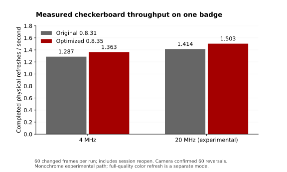

# Refresh benchmark — 8 November 2026

One ESP32-S3 Billboard Badge, E2969JS0B1 960 × 672 BWR panel, ESP-IDF 6.0.2,
custom firmware 0.8.31. Eight consecutive autonomous USB-controlled runs each
completed 60 measured frames. A MacBook camera recorded the changing test field
at 30 fps without audio (1000 × 700 crop at camera position 480,350). Anonymized telemetry is in
[`data/refresh-2026-11-08.csv`](../data/refresh-2026-11-08.csv).

## Results

| Pattern | Requested / actual MHz | FPS | Mean call ms | Steady call ms | RAM write ms | Panel pull ms |
| --- | --- | ---: | ---: | ---: | ---: | ---: |
| Moving block | 4 / 4 | 1.490 | 671.2 | 627.0 | 8.7 | 587.6 |
| Moving block | 5 / 5 | 1.493 | 669.8 | 626.7 | 8.1 | 587.5 |
| Checkerboard | 4 / 4 | 1.287 | 777.0 | 732.6 | 91.6 | 588.1 |
| Checkerboard | 5 / 5 | 1.319 | 758.3 | 715.1 | 74.7 | 587.6 |
| Checkerboard | 8 / 8 | 1.367 | 731.4 | 689.7 | 50.2 | 586.8 |
| Checkerboard | 12 / 11.428 | 1.389 | 719.8 | 679.1 | 38.2 | 587.3 |
| Checkerboard | 20 / 20 | 1.414 | 707.1 | 667.0 | 26.1 | 588.3 |
| Checkerboard, repeat | 4 / 4 | 1.289 | 775.9 | 731.7 | 90.2 | 588.7 |

20 MHz improved checkerboard throughput by **9.9%** over the first 4 MHz run.
Mean write time fell by about 71.5%, while the panel pull stayed near 588 ms.
The repeat 4 MHz run differed by about 0.15% in throughput. Moving a small block
benefited very little because it transfers fewer changed pixels.

## What was timed

The test field is below a static status area. Warmup and the result screen are
excluded. There is no deliberate pacing between measured calls. FPS is completed
frames divided by device-measured burst elapsed time; each changed call in these
runs triggered one panel pull. Every run includes one partial-session reopen.
The mean includes that reopen; the steady mean excludes reopened calls. The CSV
also records rendering, difference scanning, bytes and session reopen counts.
Phase averages need not sum to the whole call because other work and session
setup are outside those phases. CPU rendering and scanning are not SPI writes.

The requested 12 MHz profile resolved to 11.428 MHz on the ESP32-S3 divider.
The integration applies the selected clock at a transaction boundary and reports
the actual configured rate. Power sequencing, BUSY waits, waveform, voltage,
session limits and shutdown handling were unchanged. Exit restored 4 MHz and
Home; that return was confirmed by camera.

## Optical and electrical limits

Heavy ghosting and pink residuals were visible at the baseline and higher clocks.
Reviewed recordings showed no obvious new gross transfer corruption, and USB
telemetry recorded no panel/controller fault. This was visual screening, not
bit-perfect optical verification, a contrast measurement or a lifetime test.
Different clocks put the animation at different phases at a given video time;
stills alone cannot establish that one profile has better contrast.

The camera can reveal missed transitions and large artifacts but cannot resolve
SPI integrity or certify waveform settling. A logic analyzer/oscilloscope and
controlled optical chart measurements would be needed for those claims. This
single-board sequence does not establish a reliable maximum operating clock.

The vendor's [archived Large BW/BWR SPI page](https://docs.pervasivedisplays.com/knowledge/Archives/Hardware/Screens/large-epds/spi-protocol.html)
lists a 5 MHz write limit for the matching legacy family. The current
[Wide Large procedure](https://docs.pervasivedisplays.com/knowledge/Hardware/epd-usage/Screens/Wide_Large/update-procedure.html)
states 20 MHz writes and 2.5 MHz reads, but describes a newer controller and
film generation. It is not the electrical specification for `969_JS_0B`.
Here 8, 12 and 20 MHz are experimental overclock profiles; 20 MHz is a measured
4x interface overclock. The normal default remains 4 MHz. Faster transfers
alone cannot eliminate measured pull time; shorter waveforms require separate
panel-specific evidence.

## Reproduce

Use compatible firmware exposing the [bounded USB commands](USB_BENCHMARK_PROTOCOL.md).
Install pyserial and FFmpeg; frame the entire changing field and start with an
idle panel. Opening serial can reset the board on macOS. The controller waits
for Home before requesting the benchmark app.

```sh
python3 tools/auto_refresh.py /dev/cu.usbmodem101 --camera 0 --crop 1000:700:480:350 --frames 60 \
  --cases 0:4,0:5,2:4,2:5,2:8,2:12,2:20,2:4 --review
```

At each REVIEW, inspect the local recording/latest image, then create `continue`
in that trial directory, or `stop` to end. The review wait is bounded. Do not
retry a BUSY fault automatically. Raw video and device-specific serial logs stay
in ignored local artifacts; only aggregate measurements are published.

## Software pipeline follow-up: 0.8.32–0.8.35



The [new pipeline](REFRESH_PIPELINE.md) was then tested on the same badge.
Each result below is 60 calls and 60 physical pulls. Reopen time remains included
in end-to-end FPS. The full progression is in
[`refresh-pipeline-2026-11-08.csv`](../data/refresh-pipeline-2026-11-08.csv).

| Firmware / checkerboard profile | FPS | Steady call ms | Draw ms | Diff ms | Write ms | Pull/BUSY ms |
| --- | ---: | ---: | ---: | ---: | ---: | ---: |
| Original 0.8.31, 4 MHz | 1.287 | 732.6 | 27.5 | 11.0 | 91.6 | 588.1 |
| Original 0.8.31, 20 MHz | 1.414 | 667.0 | 27.2 | 11.1 | 26.1 | 588.3 |
| Byte raster / extents 0.8.32, 4 MHz | 1.339 | 702.5 | 9.9 | 6.6 | 89.6 | 587.5 |
| DMA overlap 0.8.34, 20 MHz | 1.487 | 632.6 | 9.8 | 6.7 | 18.5 | 588.8 |
| Joint scan / finer polling 0.8.35, 4 MHz | 1.363 | 689.2 | 9.7 | 5.2 | 82.2 | 583.2 |
| 0.8.35, 5 MHz | 1.396 | 673.3 | 9.7 | 4.9 | 66.5 | 583.1 |
| 0.8.35, 20 MHz | 1.502 | 625.6 | 9.9 | 5.2 | 18.6 | 582.9 |
| 0.8.35, 20 MHz repeat | 1.503 | 625.4 | 9.9 | 5.0 | 18.3 | 583.0 |

The final repeated 20 MHz result is 16.8% above the original 4 MHz result and
6.3% above the original 20 MHz result. The 4 MHz result improved 5.9% through
software changes alone. Repeated final 20 MHz throughput differed by 0.04%.
The approximately 5 ms reduction in reported pull/BUSY time comes from reducing
host detection overshoot; the electrical waveform was not shortened.

### Camera proof

`tools/analyze_checker.py` samples 154 fixed 5 × 5 patches inside the checker field,
with alternating signs. It requires meaningful contrast, uses 30% hysteresis,
and counts visible reversals. All final 4/5/20 MHz runs and the successful repeat
showed **60 reversals**, matching 60 device-reported pulls.

| Profile | Camera mean steady interval | Device steady call |
| --- | ---: | ---: |
| Original 4 MHz | 732.3 ms | 732.6 ms |
| Original 20 MHz | 667.3 ms | 667.0 ms |
| Optimized 4 MHz | 688.6 ms | 689.2 ms |
| Optimized 5 MHz | 673.1 ms | 673.3 ms |
| Optimized 20 MHz | 625.9 ms | 625.6 ms |

The camera is 30 fps; individual transitions are quantized to about 33 ms.
Averaging the intervals over the burst reduces endpoint quantization error.
Intervals above 1.2 seconds are excluded from the camera's steady mean because
the known session reopen interrupts the otherwise steady cadence. The result
establishes visible pattern reversals, not per-pixel contrast or complete settling.

The camera moved away during the 0.8.32 20 MHz trial, so that run remains
telemetry-only. One final repeat was cancelled after a host serial reader parsed
a timeout fragment as a full response. The reader now buffers until newline;
a regression test injects 256-byte fragments and empty timeout reads. The repeat
was rerun successfully. Neither excluded trial is used as optical proof.

The remaining dominant time is the roughly 580 ms electrical pull plus transfer
and CPU work. These measurements establish the fastest tested profiles in this
sequence, not an absolute hardware limit. The nominal 31.2-second BWR refresh in
the [manufacturer's E2969JS0B1 datasheet](https://www.mouser.com/datasheet/2/1089/1P285_00_01_E2969JS0B1_20210517-3135607.pdf)
is a different, full-quality three-color operation. This experimental fast path
moves black/white content with brown/pink ghosting; the two must not be presented
as equal-quality modes.

## Full music-video benchmark

The owner supplied a local 215.232-second copy of Rick Astley's “Never Gonna
Give You Up”. It was converted into 323 frames sampled at 1.5 fps, ordered-dithered
at 240 × 156 and expanded 4× on the badge. The same validated clip was used for
both complete runs on firmware 0.8.35. It is privately built into this badge's
RickVideo menu mode; the public repository contains only the generic app/codec
and tools, with no source video, derived frames or audio.

| Requested SPI profile | Frames processed | Physical pulls | Elapsed | Presentation rate | Physical refresh rate |
| --- | ---: | ---: | ---: | ---: | ---: |
| 4 MHz | 323 | 319 | 251.518 s | 1.284 fps | 1.268 Hz |
| 20 MHz experimental | 323 | 319 | 214.010 s | 1.509 fps | 1.491 Hz |

The faster profile improved throughput **17.5%** on this video. Both runs contain
five session reopens, no deliberate playback pacing and no frame dropping. A
byte comparison of the prepared source independently finds exactly four
unchanged consecutive frames; those account for the difference between 323
frame calls and 319 physical pulls. The final sampled clip takes approximately
its original source duration to play at the faster profile, at this low temporal
resolution. It is not 30 fps video.

Mean RAM-write time fell from 143.36 to 31.02 ms per input frame. Panel pull/BUSY
time remained about 583 ms per physical pull. No controller fault was reported.
The aggregate measurements are in [`video-2026-11-08.csv`](../data/video-2026-11-08.csv).

The camera recorded both complete passes at 30 fps without audio. Nine baseline
samples and eight fast samples across the recordings matched successively later
source frames. Perspective-corrected, blurred correlation ranged 0.67–0.89 for
4 MHz and 0.53–0.81 for 20 MHz. This establishes recognizable changing content
throughout the sampled run, with dithering, glare and ghosting visible. It does
not establish bit-perfect pixels or that higher SPI improves image quality.
The source frames occur at different wall-clock times in the two passes.

The badge returned to Home afterward. Video mode restores the normal 4 MHz
request when it exits. Its private built-in clip reloads after restart, so the
owner can use **RickVideo → MENU −** for the 20 MHz experimental replay; A starts
a default 4 MHz replay after reopening the app. Public integration instructions
and local conversion commands are in [VIDEO.md](VIDEO.md).

### Closure-free poster pass

Firmware 0.8.55 replaced the loop's all-white closure with one complete base
image followed by 94 narrow motion and return operations. A bounded 20 MHz loop
completed in 6.437 seconds (**14.604 operations/second**) with 94 pulls, no
fault, cancellation or session reopen. The preceding 0.8.54 build completed the
same number of operations at 14.631 operations/second, so the persistent-base
change reduced measured cadence by only 0.18%.

An independent analysis of the owner's 25.352-second, approximately 120 fps
phone recording perspective-corrected the panel and sampled it at about 30 fps.
During steady playback from 1.5 to 10.5 seconds, subject-to-paper separation had
a minimum of 156 and median of 160 grayscale levels; every sample exceeded the
120-level acceptance threshold. No blank frame, full-width white closure or
legible prior menu appeared in the loop, and at least three distinct arm/hand
poses were visible. The one-time base appearance took about 0.267 seconds,
0.017 seconds beyond the nominal 0.25-second faint limit. Gray edge trails,
rectangular band boundaries and occasional pink residual blocks remain visible.

The private recording is identified by SHA-256
`36a543247f233de410e2b8c08d05b066a12d34a09146a04b50a37097f4785ed9` but is
not distributed. These measurements establish recognizable, high-contrast
looping motion under that recording geometry; they are not absolute
colorimetry or a panel-lifetime claim.
